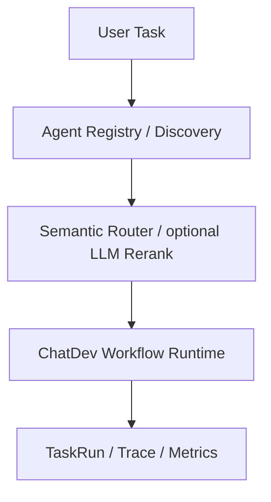

# AgentHub

[English](README.md) | **简体中文**

**AgentHub 根据自然语言任务发现并运行合适的 Agent。** 项目基于 [OpenBMB/ChatDev 2.0](https://github.com/OpenBMB/ChatDev)，新增 Agent 登记、能力发现、动态路由和可观测的业务运行记录；复用 ChatDev 的 Workflow Runtime、WebSocket 执行链、工具和前端。P0 面向可信本地/内部环境，已发布 `v1.0.0`。

[观看 225 秒 T48 Demo](demo/agenthub_t48_demo.mp4) · [Demo 说明](demo/README.md) · [五条 Run 原始记录](demo/t48_evidence_2026-10-09.json)

录屏包含一次新的 UI 提交、已完成真实 Provider Run 的回放、Registry 操作和证据看板。五条合成任务验收 Run 为 **4 success、1 rejected**；它们不是生产流量或答案质量得分。

## 核心特性

- **Agent Registry 与 Discovery**：管理已审阅的 Agent 元数据，从目录中检索可用能力。
- **Semantic Routing**：根据 Embedding 候选选择一个 Agent，无合适匹配时拒绝任务。
- **可选 LLM Rerank**：完成配置后，让 LLM 仅从已召回的候选中选择。
- **执行与可观测性**：通过 ChatDev 运行服务端批准的薄 Workflow，查看业务结果、路由 Trace 和 Metrics。

新增 Agent 需要经批准的元数据与服务端 Workflow 映射；平台不执行任意上传的 Workflow。

## 基于 ChatDev 2.0 的二次开发

| 复用 ChatDev | AgentHub 新增 |
| --- | --- |
| YAML Workflow Runtime、Agent 节点、Provider 和工具 | 版本化业务 Agent Registry 与能力发现 |
| WebSocket 执行、日志、附件和取消 | 语义路由、可选 Top-K LLM 重排及无匹配拒绝 |
| FastAPI 与 Vue 前端 | AgentHub 任务/Registry 页面、持久化业务 Run、Trace、Metrics 与评测 |

原有 Manual YAML 工作流入口仍可使用。[冻结设计](AGENTHUB_DESIGN.md)与[实现指南](docs/agenthub.md)说明上游 Runtime 和 AgentHub 增量的边界。

## How to Use · 使用方法

1. **管理 Registry**：打开 `/agenthub/registry`，查看六个示例 Agent 的能力与启用状态。
   <!-- TODO(owner): 在此插入已核实的 Registry 截图或 GIF。 -->
2. **提交自然语言任务**：打开 `/launch`，选择 **AgentHub task**，输入任务描述。
   <!-- TODO(owner): 在此插入已核实的任务提交截图或 GIF。 -->
3. **选择路由策略**：使用 `semantic`；配置 LLM 后可选 `semantic_llm` 对召回候选重排。
   <!-- TODO(owner): 在此插入已核实的候选/路由截图或 GIF。 -->
4. **查看执行结果**：检查所选 Agent、ChatDev 输出、业务状态与路由 Trace。
   <!-- TODO(owner): 在此插入已核实的结果/Trace 截图或 GIF。 -->
5. **演示拒绝与启停**：提交无匹配任务，再在 Registry 中禁用并恢复 Agent，比较后续路由结果。
   <!-- TODO(owner): 在此插入已核实的拒绝与 Agent 状态素材。 -->

可跟随[现有 Demo 视频与场景说明](demo/README.md)操作。业务 `success` 需要目标 Agent 的有效 Outcome 和 Workflow 正常完成，不代表答案质量经过评测。

## Architecture · 系统架构



AgentHub 每个任务选择一个已登记的 Agent。图示为主路径；无合适 Agent 的任务会在执行前被拒绝。数据契约和实现细节见[冻结设计](AGENTHUB_DESIGN.md)、[实现与部署指南](docs/agenthub.md)、[评测方法](evaluation/README.md)。

## Docker Quick Start

需要 Docker Engine 与 Compose，以及可用的聊天和 Embedding Provider。从仓库根目录执行：

```bash
git clone https://github.com/hongmuyu/AgentHub.git
cd AgentHub
[ -f .env ] || cp .env.example .env
# 启动前私下编辑 .env；见 docs/agenthub.md。
docker compose config --quiet
docker compose build backend frontend
docker compose up -d
docker compose exec -T backend python -m server.services.agenthub.demo_catalog
```

在已忽略的 `.env` 中配置 `BASE_URL`、`API_KEY`、`MODEL_NAME` 和 `AGENTHUB_EMBEDDING_*` 变量；`semantic_llm` 还需要 `AGENTHUB_RERANK_*` 变量及对应 Provider 凭据。Embedding/Rerank 的端点与模型设置必须匹配[冻结的 T43 校准](evaluation/t43_live_calibration_2026-10-08.json)。请按[完整配置说明](docs/agenthub.md#standard-docker-setup)填写；`.env.example` 是占位模板，`.env.docker` 仅包含非秘密 Docker 设置。

服务启动后，打开 [Launch](http://localhost:5173/launch) 或 [Registry](http://localhost:5173/agenthub/registry)。后端默认端口 `6400`，前端默认端口 `5173`。目录命令会校验并登记六个已审阅的示例 Agent。

## Benchmark · 核心结果

[T43 真实路由测试](evaluation/t43_live_test_2026-10-08.json)使用 DashScope Embedding 与 DeepSeek Rerank。60 条合成标注样例分为 30 条 calibration 和 30 条 independent test；测试集中 24 条任务有可匹配 Agent。

| 策略 | Top-1 路由准确率 | 路由 p50 / p95 | 基础设施错误 |
| --- | ---: | ---: | ---: |
| Semantic | 11/24 | 368 / 643 ms | 0 |
| Semantic + LLM Rerank | 18/24 | 2199 / 10067 ms | 2 |

两次重排错误为响应截断，延迟仍包含这些调用。调整 Rerank 输出上限后复用了测试集，但 K 和置信度阈值保持冻结。这组小样本路由比较**不**衡量 Workflow 成功率、Task Quality、生产负载或 SLA。精确数值、分母、前次尝试及独立的 live/offline 目录规模结果见[原始记录与方法](evaluation/README.md)。

## 文档与限制

[架构与决策](AGENTHUB_DESIGN.md) · [部署与操作](docs/agenthub.md) · [评测证据](evaluation/README.md) · [Demo](demo/README.md) · [发布说明](docs/RELEASE_NOTES.md) · [仓库审计](docs/REPOSITORY_AUDIT.md) · [简历材料](docs/PORTFOLIO.md) · [面试指南](docs/INTERVIEW_GUIDE.md)

P0 在可信本地/内部环境中每个任务运行一个 Agent，不提供公开多租户或未审阅 Agent 上传。已完成的业务记录在重启后仍可查询；进行中的 WebSocket/Provider 工作不能续跑。Task Quality 未经独立评测，未知 Token 用量保持未知。完整 Python 套件因继承 WebSocket 测试夹具阻塞仍为 **NOT VERIFIED**；限定范围的通过结果及其他继承问题见[仓库审计](docs/REPOSITORY_AUDIT.md)。

## 上游致谢与许可

基于 **OpenBMB/ChatDev 2.0（DevAll）**。原版 Runtime、Workflow 系统、前端、工具及资源归功于其作者和贡献者；上游历史与引用见 [ChatDev 官方仓库](https://github.com/OpenBMB/ChatDev)。**Copyright 2025 OpenBMB.** 保留上游 [Apache-2.0 许可证](LICENSE)及源码/资源许可声明。
