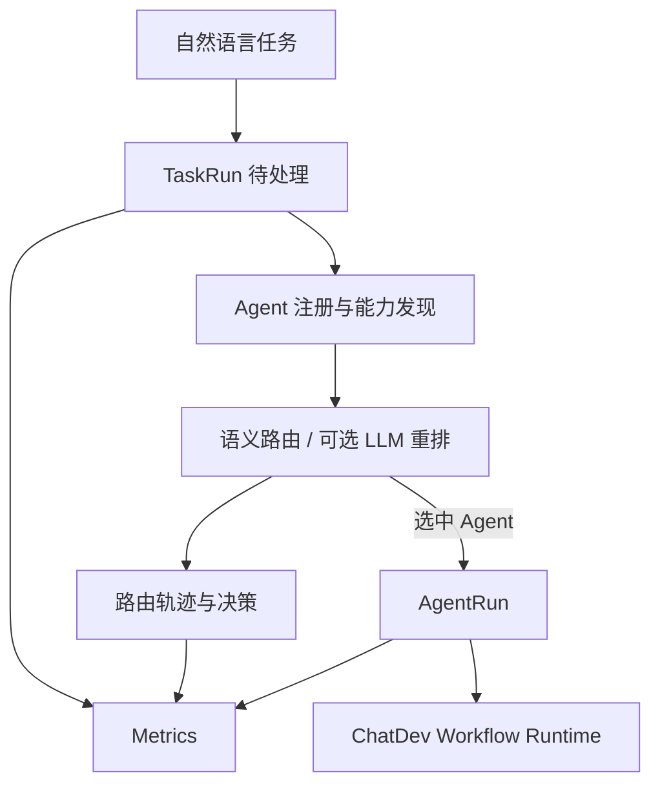

# AgentHub

> 🧭 让自然语言任务找到合适的 Agent，并看清每一次路由与执行。

**AgentHub** 基于 [OpenBMB/ChatDev 2.0](https://github.com/OpenBMB/ChatDev)，新增 Agent 登记、能力发现、动态路由和可观测的业务运行记录；复用 ChatDev 的 Workflow Runtime、WebSocket 执行链、工具和前端。当前版本面向可信本地/内部环境。首次使用按下方部署步骤操作；希望修改代码可直接阅读[中文开发指南](docs/development.md)。

**快速导航**　🚀 [部署运行](#部署运行第一次请按顺序完成) · 🛠️ [本地开发](docs/development.md) · 🧭 [系统架构](#readme-architecture) · 📊 [评测结果](#readme-benchmarks)

🎬 [观看 225 秒演示](demo/agenthub_t48_demo.mp4) · [Demo 说明](demo/guide.md) · [五条 Run 原始记录](demo/t48_evidence_2026-10-09.json)

录屏包含一次新的 UI 提交、已完成真实 Provider Run 的回放、Registry 操作和证据看板。五条合成演示任务 Run 为 **4 success、1 rejected**；它们不是生产流量或答案质量得分。

---

## ✨ 核心特性

- 🗂️ **Agent Registry 与 Discovery**：管理已审阅的 Agent 元数据，从目录中检索可用能力。
- 🧭 **Semantic Routing**：根据 Embedding 候选选择一个 Agent，无合适匹配时拒绝任务。
- 🔀 **可选 LLM Rerank**：完成配置后，让 LLM 仅从已召回的候选中选择。
- 📈 **执行与可观测性**：通过 ChatDev 运行服务端批准的薄 Workflow，查看业务结果、路由 Trace 和 Metrics。

新增 Agent 需要经批准的元数据与服务端 Workflow 映射；平台不执行任意上传的 Workflow。

## 🧩 基于 ChatDev 2.0 的二次开发

| 复用 ChatDev | AgentHub 新增 |
| --- | --- |
| YAML Workflow Runtime、Agent 节点、Provider 和工具 | 版本化业务 Agent Registry 与能力发现 |
| WebSocket 执行、日志、附件和取消 | 语义路由、可选 Top-K LLM 重排及无匹配拒绝 |
| FastAPI 与 Vue 前端 | AgentHub 任务/Registry 页面、持久化业务 Run、Trace、Metrics 与评测 |

原有 Manual YAML 工作流入口仍可使用。[实现指南](docs/agenthub.md)说明上游 Runtime 和 AgentHub 增量的边界。

---

## 部署运行：第一次请按顺序完成

> 🚀 **第一次部署从这里开始。** 按 1～6 步完成环境准备、配置、启动和首次任务。

以下命令适用于 Linux / macOS 终端或 Windows 的 WSL2，全部从仓库根目录执行。首次启动推荐 Docker Compose；不需要先安装宿主机 Python / Node.js，也不需要先跑测试。

### 1. Fork、克隆与环境准备

先安装并启动 Docker Engine + Compose 插件，或 Docker Desktop。确认下面两条命令都能正常输出版本；`docker info` 应能连接 Docker 服务：

```bash
docker --version
docker compose version
docker info
```

希望继续开发时，先在 GitHub 点击本仓库右上角 **Fork**，然后克隆自己的仓库（替换下方用户名）：

```bash
git clone https://github.com/你的GitHub用户名/AgentHub.git
cd AgentHub
```

只想体验时也可直接克隆 `https://github.com/hongmuyu/AgentHub.git`。已有仓库时直接进入目录，不要再次克隆。后端默认占用 `6400`，前端默认占用 `5173`；首次构建需要联网下载镜像和依赖。

### 2. 创建并填写根目录 .env

```bash
[ -f .env ] || cp .env.example .env
```

> 🔑 **先填真实配置，再启动。** 仅复制 `.env.example` 不能运行完整 AgentHub：模板中的 Embedding 配置和 `MODEL_NAME` 默认被注释。

用编辑器打开根目录 `.env`，按下面的完整示例填写。已有同名配置时修改原行，不要重复追加。

```dotenv
# 聊天模型：由选中的 Agent 执行任务，三个值必须来自同一个可用的 OpenAI 兼容服务。
BASE_URL=https://你的聊天服务提供方/v1
API_KEY=替换为该聊天服务的真实密钥
MODEL_NAME=替换为该服务实际支持的聊天模型名称

# 能力索引与语义路由：以下公开配置与仓库当前冻结校准一致，请原样保留。
AGENTHUB_EMBEDDING_BASE_URL=https://dashscope.aliyuncs.com/compatible-mode/v1
AGENTHUB_EMBEDDING_MODEL=text-embedding-v4
AGENTHUB_EMBEDDING_MODEL_KEY=qwen-text-embedding-v4-1024
AGENTHUB_EMBEDDING_DIMENSIONS=1024
AGENTHUB_EMBEDDING_API_KEY_ENV=DASHSCOPE_API_KEY
DASHSCOPE_API_KEY=替换为可访问上述DashScope端点和模型的真实密钥
```

- `AGENTHUB_EMBEDDING_API_KEY_ENV=DASHSCOPE_API_KEY` 填的是**变量名**；真正的密钥填在下一行 `DASHSCOPE_API_KEY=...`。聊天密钥与 Embedding 密钥分别配置。
- 聊天模型可以使用你已有的兼容服务；`MODEL_NAME` 不能填 Embedding 模型名称。上述聊天三项是占位符，必须替换。
- 首次使用先选择 `semantic`，无需配置 DeepSeek 重排；已有 `.env` 中若有 `AGENTHUB_RERANK_*` 配置，先全部注释，再按[可选重排配置](docs/agenthub.md#optional-rerank)启用。
- 当前应用会校验 Embedding 端点、模型、模型标识和维度的配置指纹。任意更换这些值（包括端点尾部斜杠）可能触发 `AGENTHUB_CALIBRATION_MISMATCH`。没有相应 DashScope 服务时，只能先体验[原生手动 Workflow](docs/agenthub.md#manual-workflow)，不能声称已启动完整 AgentHub。
- 密钥放在本地 `.env`，不要提交到 Git，也不要贴到 Issue。登记目录会调用 Embedding，任务执行会调用聊天模型，费用按提供方计量。

### 3. 构建镜像并准备可写目录

```bash
docker compose config --quiet
docker compose build backend frontend
docker compose run --rm --no-deps --user root backend sh -c 'install -d -o appuser -g appuser /app/data /app/logs /app/WareHouse'
```

最后一条只准备运行数据目录及其归属：后端使用非 root 用户 `appuser`，而代码目录通过挂载进入容器。它不会删除已有数据。若旧数据文件仍提示权限不足，见[权限排查](docs/agenthub.md#troubleshooting)。`config --quiet` 只检查 Compose 配置，不验证密钥是否可用。

### 4. 启动并确认后端已响应

```bash
docker compose up -d
docker compose ps
curl -fsS --retry 12 --retry-delay 2 --retry-connrefused http://localhost:6400/health
```

两个服务应处于运行状态，健康接口应返回 JSON。若容器反复重启或请求失败，先查看 `docker compose logs --tail=80 backend`，按[常见问题](docs/agenthub.md#troubleshooting)处理，再继续。健康接口正常只说明服务响应，不代表模型调用已成功。

### 5. 登记六个示例 Agent

```bash
docker compose exec -T backend python -m server.services.agenthub.demo_catalog
curl -fsS 'http://localhost:6400/api/agenthub/agents?limit=100'
```

登记命令会校验 Workflow 并构建语义索引，成功后输出六个 `runtime_ref` 对应的 `agent_id` 和版本。新目录的查询结果应包含六个启用的 Agent。目录未变时重复执行会保留原有 ID / 版本；已禁用的 Agent 不会因此自动恢复启用。

### 6. 打开页面并提交第一条任务

1. 打开 [Agent 管理页面](http://localhost:5173/agenthub/registry)，确认示例 Agent 已登记且启用。
2. 打开 [任务页面](http://localhost:5173/launch)，选择 **AgentHub 任务（AgentHub task）**，路由策略选 `semantic`。
3. 输入：`给定响应时间 10、11、12、13、80 毫秒，请计算中位数和极差，并指出需要检查的异常值。`
4. 提交后查看候选、选中的 Agent、输出和业务状态。页面负责建立 WebSocket 会话，不需要自己编造 `session_id`。
5. 等待业务状态到达 `success`、`failed`、`rejected` 或 `cancelled`。HTTP 202、“请求已接受”和 Workflow 完成都不能单独证明业务成功。

中文任务可用于操作演示，但具体选择及结果以当前模型响应为准；仓库的历史路由准确率只对应其合成评测样例。

### 后续启动、配置修改与停止

```bash
# 未修改配置：启动已有服务。
docker compose up -d

# 修改 .env 后：重新创建容器以加载新环境；不必重新构建镜像。
docker compose up -d --force-recreate backend frontend

# 停止服务，保留容器和数据。
docker compose stop
```

变更前先等待正在执行的任务结束。`docker compose restart` 不会重新加载 Compose 的 `.env`；后端重启也不会续跑进行中的模型调用。已完成记录保存在宿主机 `data/agenthub.db`，不要为了排错删除数据库。

完整说明：[部署、配置与排查](docs/agenthub.md) · [本地开发](docs/development.md) · [Demo 操作](demo/guide.md)。

<a id="readme-architecture"></a>
## 🧭 系统架构



AgentHub 每个任务选择一个已登记的 Agent。图示为主路径；无合适 Agent 的任务会在执行前被拒绝。数据契约和实现细节见[实现与部署指南](docs/agenthub.md)及[评测方法](evaluation/guide.md)。

<a id="readme-benchmarks"></a>
## 📊 基准测试与核心结果

[T43 真实路由测试](evaluation/t43_live_test_2026-10-08.json)使用 DashScope Embedding 与 DeepSeek Rerank。60 条合成标注样例分为 30 条 calibration 和 30 条 independent test；测试集中 24 条任务有可匹配 Agent。

| 策略 | Top-1 路由准确率 | 路由 p50 / p95 | 基础设施错误 |
| --- | ---: | ---: | ---: |
| Semantic | 11/24 | 368 / 643 ms | 0 |
| Semantic + LLM Rerank | 18/24 | 2199 / 10067 ms | 2 |

两次重排错误为响应截断，延迟仍包含这些调用。调整 Rerank 输出上限后复用了测试集，但 K 和置信度阈值保持冻结。这组小样本路由比较**不**衡量 Workflow 成功率、Task Quality、生产负载或 SLA。精确数值、分母、前次尝试及独立的 live/offline 目录规模结果见[原始记录与方法](evaluation/guide.md)。

## 📚 技术文档与限制

[架构、部署与操作](docs/agenthub.md) · [本地开发](docs/development.md) · [上游 Workflow 使用文档](docs/user_guide/zh/index.md) · [评测证据](evaluation/guide.md) · [Demo](demo/guide.md) · [发布说明](docs/RELEASE_NOTES.md)

P0 在可信本地/内部环境中每个任务运行一个 Agent，不提供公开多租户或未审阅 Agent 上传。已完成的业务记录在重启后仍可查询；进行中的 WebSocket/Provider 工作不能续跑。Task Quality 未经独立评测，未知 Token 用量保持未知。完整 Python 套件因继承 WebSocket 测试夹具阻塞仍为 **NOT VERIFIED**；限定范围的通过结果及其他限制见[部署与验证指南](docs/agenthub.md#verified-deployment-scope-and-limits)。

## 🛠️ 开发与贡献

欢迎提交附有复现步骤的 Issue 或范围清晰的 PR。修改前阅读[中文开发指南](docs/development.md)，了解环境安装、前后端启动和代码入口；历史验证范围见[验证说明](docs/agenthub.md#verified-deployment-scope-and-limits)。运行应用不要求先执行测试。请勿提交私有 `.env`、数据库、日志或构建产物。

## 🙏 上游致谢与许可

基于 **OpenBMB/ChatDev 2.0（DevAll）**。原版 Runtime、Workflow 系统、前端、工具及资源归功于其作者和贡献者；上游历史与引用见 [ChatDev 官方仓库](https://github.com/OpenBMB/ChatDev)。**Copyright 2025 OpenBMB.** 保留上游 [Apache-2.0 许可证](LICENSE)及源码/资源许可声明。仓库内的 Inter 字体另保留其 [SIL Open Font License](frontend/src/assets/styles/fonts/Inter/OFL.txt)。
