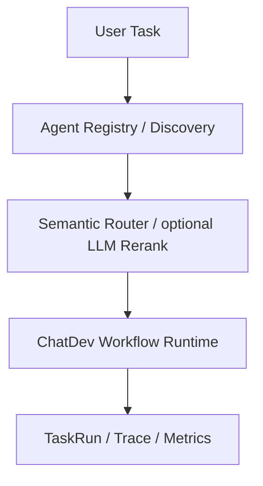

# AgentHub

**English** | [简体中文](README-zh.md)

**AgentHub helps users find and run the right Agent for a natural-language task.** It adds Agent registration, capability discovery, routing and observable business runs to [OpenBMB/ChatDev 2.0](https://github.com/OpenBMB/ChatDev). AgentHub reuses ChatDev's Workflow Runtime, WebSocket execution, tools and frontend. P0 targets a trusted local/internal environment and is released as `v1.0.0`.

[Watch the 225-second T48 Demo](demo/agenthub_t48_demo.mp4) · [Demo guide](demo/README.md) · [Original five-run record](demo/t48_evidence_2026-10-09.json)

The recording includes a fresh UI submission, replay of completed real-provider runs, Registry actions and an evidence board. Its five acceptance runs were **4 success, 1 rejected** on synthetic tasks; they are not production traffic or an answer-quality score.

## Highlights

- **Agent Registry and Discovery:** manage reviewed Agent metadata and retrieve eligible capabilities from the catalog.
- **Semantic Routing:** select one Agent from embedding-based candidates, or reject a task with no suitable match.
- **Optional LLM Rerank:** let an LLM choose only among retrieved candidates when configured.
- **Execution and Observability:** run a server-approved thin workflow through ChatDev; inspect the business result, routing trace and metrics.

Adding an Agent requires approved metadata and a server-owned workflow mapping. AgentHub does not execute arbitrary uploaded workflows.

## Built on ChatDev 2.0

| Reused from ChatDev | Added by AgentHub |
| --- | --- |
| YAML Workflow Runtime, Agent nodes, providers and tools | Versioned business Agent Registry and capability discovery |
| WebSocket execution, logs, attachments and cancellation | Semantic routing, optional Top-K LLM rerank and no-match rejection |
| FastAPI and Vue frontend | AgentHub task/Registry views, persistent business runs, traces, metrics and evaluation |

The original Manual YAML workflow path remains available. The [implementation guide](docs/agenthub.md) explains the boundary between upstream Runtime and AgentHub's additions.

## How to Use

1. **Manage the Registry:** open `/agenthub/registry` to view the six example Agents, their capabilities and enabled status.
   <!-- TODO(owner): Insert a verified Registry screenshot or GIF here. -->
2. **Submit a task:** open `/launch`, choose **AgentHub task**, and enter a natural-language request.
   <!-- TODO(owner): Insert a verified task-submission screenshot or GIF here. -->
3. **Choose routing:** use `semantic`, or select `semantic_llm` to rerank the retrieved candidates when an LLM is configured.
   <!-- TODO(owner): Insert a verified candidate/routing screenshot or GIF here. -->
4. **Inspect the run:** check the selected Agent, ChatDev output, business status and routing trace.
   <!-- TODO(owner): Insert a verified result/trace screenshot or GIF here. -->
5. **Try rejection and status changes:** submit a no-match task, then disable and restore an Agent in the Registry to compare later routing results.
   <!-- TODO(owner): Insert verified rejection and Agent-status media here. -->

For a guided walkthrough, use the [existing Demo video and scenario notes](demo/README.md). A `success` business state requires a valid target-Agent outcome and normal workflow completion; it does not measure answer quality.

## Architecture



AgentHub selects one registered Agent per task. The diagram shows the main path; requests without a suitable Agent are rejected before execution. See the [implementation and deployment guide](docs/agenthub.md) and [evaluation methodology](evaluation/README.md) for the detailed contracts.

## Docker Quick Start

Docker Engine with Compose and valid chat/embedding provider access are required. From the repository root:

```bash
git clone https://github.com/hongmuyu/AgentHub.git
cd AgentHub
[ -f .env ] || cp .env.example .env
# Edit the private .env before starting; see docs/agenthub.md.
docker compose config --quiet
docker compose build backend frontend
docker compose up -d
docker compose exec -T backend python -m server.services.agenthub.demo_catalog
```

Configure `BASE_URL`, `API_KEY`, `MODEL_NAME` and the `AGENTHUB_EMBEDDING_*` variables in the ignored `.env`; `semantic_llm` also needs the `AGENTHUB_RERANK_*` variables and its provider key. The embedding/rerank endpoint and model settings must match the [frozen T43 calibration](evaluation/t43_live_calibration_2026-10-08.json). Use the [complete configuration instructions](docs/agenthub.md#standard-docker-setup); `.env.example` is a placeholder template, while `.env.docker` contains non-secret Docker settings.

Open [Launch](http://localhost:5173/launch) or the [Registry](http://localhost:5173/agenthub/registry) after startup. Default backend port: `6400`; frontend port: `5173`. The catalog command validates and registers six reviewed example Agents.

## Benchmark

The [T43 live routing test](evaluation/t43_live_test_2026-10-08.json) used DashScope embeddings and DeepSeek reranking. Its 60 synthetic labeled cases were split into 30 calibration and 30 independent test cases; 24 test cases had a matchable Agent.

| Strategy | Top-1 routing accuracy | Routing p50 / p95 | Infrastructure errors |
| --- | ---: | ---: | ---: |
| Semantic | 11/24 | 368 / 643 ms | 0 |
| Semantic + LLM Rerank | 18/24 | 2199 / 10067 ms | 2 |

The two rerank errors were truncated responses; latency includes those calls. The test split was reused after changing the rerank output limit, while K and the confidence threshold stayed frozen. This small routing comparison does **not** measure workflow success, Task Quality, production load or an SLA. See the [raw results and methodology](evaluation/README.md) for exact values, denominators, the prior attempt, and separate live/offline catalog-size results.

## Documentation and limits

[Architecture, setup and operation](docs/agenthub.md) · [Evaluation evidence](evaluation/README.md) · [Demo](demo/README.md) · [Release notes](docs/RELEASE_NOTES.md)

P0 runs one Agent per task in a trusted local/internal setup. It does not provide public multi-tenancy or unreviewed Agent uploads. Completed business records remain queryable after restart; in-flight WebSocket/provider work does not resume. Task Quality has not been independently assessed, and unknown token usage remains unknown. The full Python suite is **NOT VERIFIED** because of an inherited WebSocket test fixture; the [deployment and verification guide](docs/agenthub.md#verified-deployment-scope-and-limits) records bounded passing checks and other limits.

## Upstream and license

Based on **OpenBMB/ChatDev 2.0 (DevAll)**. Credit for the original Runtime, Workflow system, frontend, tools and resources belongs to its authors and contributors; see the [official ChatDev repository](https://github.com/OpenBMB/ChatDev) for upstream history and citations. **Copyright 2025 OpenBMB.** The upstream [Apache-2.0 license](LICENSE) and source/resource notices are retained.
