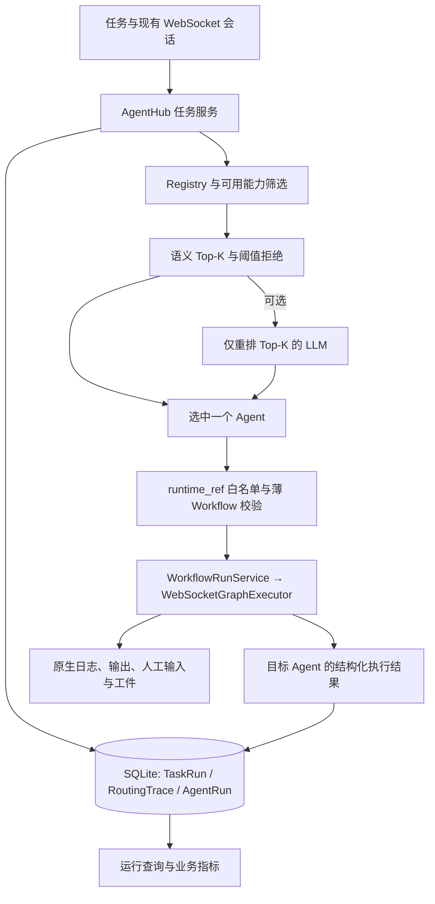

# AgentHub 部署、运行与实现指南

AgentHub 基于 ChatDev 2.0，面向可信本地或内部环境，提供业务 Agent 注册、能力发现、单 Agent 路由、执行和持久化追踪。第一次使用请按 [README 部署步骤](../README.md#部署运行第一次请按顺序完成)操作；宿主机开发见[中文开发指南](development.md)，原生 Workflow 见[中文用户文档](user_guide/zh/index.md)。

## 架构与执行边界



[Registry](../server/services/agenthub/registry.py) 在 SQLite 中保存元数据版本和向量索引；[Discovery](../server/services/agenthub/discovery.py) 筛选启用状态、有效 Workflow 和匹配的索引版本。[Router](../server/services/agenthub/router.py) 依据能力元数据选择，不按六个示例 Agent 的名字写分支。`semantic` 选择语义 Top-1；`semantic_llm` 只在召回的 Top-K 中重排。无候选或最高分低于校准阈值时返回 `NO_SUITABLE_AGENT`。

[受控映射](../yaml_instance/agenthub_manifest.json) 将逻辑 `workflow://.../1` 引用映射到服务端薄 Workflow。新增兼容 Agent 需要注册元数据和经过审阅的 Workflow / 映射，不需要增加 Router 分支；用户不能通过 AgentHub 接口提交任意文件路径。当前每个任务只选择一个业务 Agent，不动态组建团队。

任务服务先创建 `pending` 状态的 TaskRun，再持久化路由轨迹，选中后创建 AgentRun。[执行适配器](../server/services/agenthub/workflow_dispatcher.py) 复用 `WorkflowRunService` 与原生 WebSocket 链路。`run_id` 是持久化业务运行 ID，`session_id` 是原生会话 ID；两者不能互换。附件、人工输入、下载和取消继续复用 ChatDev。

<a id="standard-docker-setup"></a>
## Docker 部署与配置

### 前提与配置加载顺序

使用仓库的 [后端 Dockerfile](../Dockerfile)、[前端 Dockerfile](../frontend/Dockerfile) 和 [compose.yml](../compose.yml)。后端镜像包含 Python 3.12，前端镜像使用 Node.js 24；宿主机只需 Git、可用 Docker / Compose 和访问镜像、依赖及模型服务的网络。

默认后端端口 `6400`，前端端口 `5173`。Compose 将仓库挂载到后端 `/app`，将 `frontend/` 挂载到前端 `/app`，并为前端 `/app/node_modules` 使用匿名卷。无需把宿主机 `node_modules` 再挂载进容器。

1. 根目录 `.env` 保存本地模型配置，按 [README 完整示例](../README.md#2-创建并填写根目录-env)填写。
2. Compose 的服务环境依次加载 `.env`、`.env.docker`；后者同名变量覆盖前者。
3. `.env.docker` 设置容器监听地址与 Vite 代理地址 `http://backend:6400`。浏览器访问的是 `http://localhost:5173`，不要在宿主机浏览器访问 `http://backend:6400`。
4. 宿主机 shell 中单独 `export` 的密钥不会自动进入当前 Compose 服务；密钥应写入被 `env_file` 加载的根目录 `.env`。
5. `.env` 使用 `变量名=值`，不要加 `export`，注释独占一行。不要把真实密钥放进 `VITE_*` 变量或公开文档。

聊天执行需要 `BASE_URL`、`API_KEY`、`MODEL_NAME`。六个示例 Workflow 使用 OpenAI 兼容聊天协议，`MODEL_NAME` 必须由对应聊天端点支持。聊天模型设置与 Embedding / 重排配置独立；不要把聊天密钥误当成 DashScope 密钥。

### 语义路由的必要配置

完整 AgentHub 必须启用 Embedding，不能只配置聊天模型。下列公开值已按仓库校准文件的 SHA-256 指纹核对；这只证明配置对应关系，不证明你的账号权限或服务当前可用：

```dotenv
AGENTHUB_EMBEDDING_BASE_URL=https://dashscope.aliyuncs.com/compatible-mode/v1
AGENTHUB_EMBEDDING_MODEL=text-embedding-v4
AGENTHUB_EMBEDDING_MODEL_KEY=qwen-text-embedding-v4-1024
AGENTHUB_EMBEDDING_DIMENSIONS=1024
AGENTHUB_EMBEDDING_API_KEY_ENV=DASHSCOPE_API_KEY
DASHSCOPE_API_KEY=替换为真实密钥
```

`AGENTHUB_EMBEDDING_API_KEY_ENV` 是密钥变量的名字；必须同时设置它指向的 `DASHSCOPE_API_KEY`。若五项 `AGENTHUB_EMBEDDING_*` 均未设置，应用只启动普通 ChatDev，AgentHub API 会报告服务未配置；只填一部分则可能在启动时报 `EMBEDDING_CONFIGURATION_MISSING`。

[启动配置代码](../server/services/agenthub/app_setup.py) 固定读取 [T43 校准文件](../evaluation/t43_live_calibration_2026-10-08.json)，冻结 `K=5`、阈值 `0.35727615782291194`。端点原始字符串、模型名称、模型标识和维度必须匹配；尾部斜杠也会影响指纹。轮换真实密钥不会改变指纹。

**换 Embedding 模型不是只改 `.env`。** 需要重新校准、重建对应索引并审阅应用的校准接入；当前没有可任意指定校准路径的启动配置。不要手改 JSON 哈希、冒用旧 model key 或删除校准校验。新的评测输出也不会自动被 Web 服务采用。

<a id="optional-rerank"></a>
### 可选：启用 semantic_llm 重排

先完成 `semantic` 的登记和任务运行，再在同一个 `.env` 中加入：

```dotenv
AGENTHUB_RERANK_BASE_URL=https://api.deepseek.com
AGENTHUB_RERANK_MODEL=deepseek-flash
AGENTHUB_RERANK_API_KEY_ENV=DEEPSEEK_API_KEY
DEEPSEEK_API_KEY=替换为可访问上述模型的真实密钥
```

此公开端点和模型与仓库冻结指纹匹配，不要随意追加 `/v1`。账号必须能访问该模型；若模型不可用，先取消全部 `AGENTHUB_RERANK_*` 配置并使用 `semantic`，不要随意换模型绕过校准。

```bash
docker compose up -d --force-recreate backend frontend
```

等待后端恢复后，在任务页选择 `semantic_llm`。重排只接收候选元数据和任务，不运行候选 Agent；调用失败会记录为 `failed`，不会自动回退。`RERANK_TRUNCATED_RESPONSE` 表示响应被截断，历史评测也出现过，不能当成无匹配或成功。

### 初始化目录、启动和日常操作

完整命令及顺序见 [README](../README.md#3-构建镜像并准备可写目录)。首次构建后准备 `data/`、`logs/`、`WareHouse/`，让镜像内的 `appuser` 可写，再启动服务。`/health` 响应后执行：

```bash
docker compose exec -T backend python -m server.services.agenthub.demo_catalog
curl -fsS 'http://localhost:6400/api/agenthub/agents?limit=100'
curl -fsS http://localhost:6400/api/agenthub/metrics
```

登记会实际调用 Embedding。新目录应出现六个启用 Agent；相同元数据重复登记保持 UUID / 版本，禁用状态也会保留。已有条目与示例冲突时返回 `DEMO_CATALOG_CONFLICT`，应检查条目并显式处理差异，不要清空数据库来重复初始化。API 支持注册、查询/搜索、分页、更新、启用和禁用；管理入口是 `/agenthub/registry`。

```bash
# 查看服务状态与最近日志；日志仅在本机排查，分享前去除敏感内容。
docker compose ps
docker compose logs --tail=80 backend
docker compose logs --tail=80 frontend

# 同一配置下停止与重新启动。
docker compose stop
docker compose up -d

# 修改 .env 后重新加载环境。
docker compose up -d --force-recreate backend frontend
```

仅 `restart` 不会更新容器创建时的环境变量。代码依赖发生变化才需要重新构建相应镜像。不要把 `docker compose down -v` 或删除 `data/` 当成常规排障步骤。

<a id="manual-workflow"></a>
## 页面使用与原生 Workflow

打开 [任务页](http://localhost:5173/launch)，选择 **AgentHub 任务（AgentHub task）**，首次选 `semantic`。可输入 README 的中位数任务，它使用给定数字，不要求外部检索工具。页面建立 WebSocket 会话、提交任务并显示候选、所选 Agent、原生输出和独立业务状态。

`POST /api/agenthub/tasks` 需要 `task`、真实且当前有效的 WebSocket `session_id`，以及可选附件 ID 和 `routing_strategy`。任意 UUID 不能充当有效会话；初次使用请通过 UI 提交。HTTP 202 只表示接受/调度，返回的 `run_id` 可用于查询：

```bash
# 将占位符替换为自己的运行 ID。
curl -fsS 'http://localhost:6400/api/agenthub/tasks/REPLACE_WITH_RUN_ID'
```

具体字段见[任务 API](../server/routes/agenthub_tasks.py)、[Registry API](../server/routes/agenthub.py)、[指标 API](../server/routes/agenthub_metrics.py)和[运行查询模型](../server/services/agenthub/run_query.py)。Research 的联网工具需要额外服务和网络；首次任务不依赖这些工具，工具配置见[中文工具文档](user_guide/zh/modules/tooling/overview.md)。

若尚无 Embedding 服务，可注释全部 `AGENTHUB_EMBEDDING_*` 和 `AGENTHUB_RERANK_*` 配置，重新创建容器，在任务页选择 **手动 YAML（Manual YAML）**，选择 `demo_loop_counter.yaml` 体验不依赖模型的原生 Workflow。原生编辑入口为 `/workflows`，执行接口仍为 `/api/workflow/execute`。这条路径没有 AgentHub 注册与路由，也不会创建 AgentHub 业务运行记录；它只能帮助先确认界面和原生执行链。

## 业务状态、数据位置与重启

- `pending` / `running`：已记录或正在执行；有输出不等于成功。
- `success`：Workflow 正常完成，且唯一目标 Agent 返回有效的结构化 `AgentExecutionOutcome=succeeded`，此前没有失败/取消信号。
- `failed`：路由基础设施、调度、模型或结构化结果失败；缺失、无效、错误节点的结果不能记为成功。
- `rejected`：没有合适 Agent（`NO_SUITABLE_AGENT`），不启动 Agent Workflow。
- `cancelled`：执行链已确认取消。仅发送取消请求还不是终态；WebSocket 断开也不会自动取消任务。

业务状态与原生会话状态分开，已提交的终态不能被覆盖。数据库 `data/agenthub.db` 使用 SQLite WAL，保存 TaskRun、RoutingTrace、AgentRun、目录和索引；`logs/` 为日志，`WareHouse/` 为原生执行工件。标准 Compose 将这些目录保留在宿主机。

Trace 记录候选/分数、策略、路由耗时、选择或安全错误码；AgentRun 记录 Agent/版本、原生状态、结构化结果状态、耗时及可用的结果引用。[指标](../server/services/agenthub/metrics.py)包含显式分母的成功/失败/拒绝率、耗时样本数、已知/未知 Token 用量、Agent 使用量与路由分布。未知 Token 不按零处理；没有评分规则或人工评估时 Task Quality 为 `null`。

已完成运行在后端重启后仍可按 `run_id` 查询，但不会恢复进行中的模型/工具调用和内存 WebSocket 会话。重启前请等待任务结束；不要删除数据库、WAL 文件或卷。历史 T46 验证了一个已完成真实运行的重启查询一致性，没有验证断点续跑。

<a id="troubleshooting"></a>
## 常见启动与运行问题

### Docker 无法连接、端口占用或构建下载失败

`docker info` 无法连接时先启动 Docker Desktop / Docker daemon，按系统管理方式配置当前用户的 Docker 权限。端口冲突时停止占用 `6400` / `5173` 的旧实例；不要同时运行同端口的宿主机开发服务和 Compose。

如需改前端对外端口，在根目录 `.env` 设置 `FRONTEND_PORT=15173`，然后重新创建容器，访问 `http://localhost:15173`。容器内部仍监听 `5173`；只修改 `.env.docker` 的 `FRONTEND_PORT` 不会改变 Compose 的端口插值。后端端口固定写在 Compose 中，首次使用请保持 `6400`。

镜像、apt、PyPI 或 npm 下载失败时，查看构建输出中具体失败阶段，检查宿主机及 Docker 的网络/代理配置后重新构建。不要因下载慢删除锁文件。容器中的 `localhost` 指向容器自身，本机模型服务不能简单照搬宿主机 `localhost` 地址；本机模型的网络接入需要单独配置。

### 权限不足、数据库不可写、无法创建 logs 或 WareHouse

后端使用 `appuser`，宿主机挂载目录可能归另一个 UID 所有。先执行 README 中的可写目录准备命令。若旧文件仍不可写，停止后端，仅修复运行数据目录归属，再启动：

```bash
docker compose stop backend
docker compose run --rm --no-deps --user root backend sh -c 'chown -R appuser:appuser /app/data /app/logs /app/WareHouse'
docker compose up -d backend
```

该命令改变这三个目录已有文件的归属，执行前确认它们确实是本项目运行目录。不要对整个仓库执行 `chmod -R 777`。宿主机开发与容器共用数据时也需留意 UID 差异。

### /health 正常，但页面提示 AgentHub 服务未配置

`REGISTRY_NOT_CONFIGURED` / `TASK_SERVICE_NOT_CONFIGURED` 通常表示 AgentHub 未启用。确认 `.env` 的五个 `AGENTHUB_EMBEDDING_*` 行没有被注释，密钥变量名及对应密钥都已填写，然后 `docker compose up -d --force-recreate backend frontend`。`/health` 不验证 Registry 或模型是否可用。

### 后端反复重启：缺少配置或校准不匹配

- `EMBEDDING_CONFIGURATION_MISSING`：五项 Embedding 配置没有填齐。
- `AGENTHUB_CALIBRATION_MISMATCH`：检查端点（包括尾部斜杠）、模型、model key、维度；启用重排时也检查其端点和模型，逐项对照本文。
- `AGENTHUB_CALIBRATION_INVALID`：检查仓库校准 JSON 是否缺失或损坏；恢复版本库中的原文件，不要编造配置指纹。
- Workflow 校验不通过：检查 `MODEL_NAME`、`BASE_URL`、`API_KEY` 是否已填，示例 YAML / manifest 是否被改动。

### 目录登记失败或目录为空

`EMBEDDING_CREDENTIAL_MISSING` 表示被选择的密钥变量没有值；`EMBEDDING_AUTH_FAILED` 表示认证失败；`EMBEDDING_RATE_LIMITED` 表示限流；超时/服务不可用需检查网络及提供方。API 可能将这些错误统一为 `EMBEDDING_NOT_READY`；登记命令可提供更具体的安全错误码。确认密钥适用于本文 DashScope 端点及模型，不要公开原始密钥。

目录为空时先完成登记命令；已有 Agent 被禁用时到管理页面恢复。`DEMO_CATALOG_CONFLICT` 需要核对已有元数据与示例差异。`NO_SUITABLE_AGENT` 是筛选/阈值拒绝，不应通过绕过阈值强行执行；同时检查目录是否为空或全部禁用。

### 页面能打开，但任务失败或一直显示运行中

先查询对应 `run_id`，区分路由、执行和结果失败。`ROUTING_STRATEGY_NOT_CONFIGURED` 表示选择了未配置的重排策略，应改用 `semantic` 或完成重排配置；`RERANK_TRUNCATED_RESPONSE` 是模型输出截断，不是成功。聊天端点/模型/密钥与 Embedding 独立，目录登记成功不证明聊天模型能执行。

WebSocket 连接异常时检查浏览器是否通过前端端口访问、前端代理 `/api` 与 `/ws` 是否指向可达后端。不要伪造 `session_id`。后端重启前尚未完成的运行不会自动恢复；保留记录，并在新会话重新提交，不能将旧记录改成成功。

<a id="routing-benchmark-reproduction-and-measured-results"></a>
## 路由评测与历史结果

详细样例、分母、逐条结果及 10/50/100 Agent 规模数据见[中文评测指南](../evaluation/guide.md)。这些是 2026-10-08 的历史结果，部署不需要重新执行评测。

60 条合成标注任务按 36 clear / 12 ambiguous / 12 no-match 分布，均分为 30 条校准、30 条测试。只用校准集选择 `K=5` 和 cosine 阈值 `0.35727615782291194`，校准得分为 Top-1 15/24、Top-K 24/24、拒绝 4/6、误接受 2/6，无基础设施错误。

测试集的 `semantic` Top-1 为 11/24，`semantic_llm` 为 18/24；共同语义 Top-K 为 24/24。拒绝率分别为 3/6 与 3/4，误接受分别为 3/6 与 1/4，后者两条 no-match 重排截断错误被排除出质量分母。每种策略均有 30 条实测路由耗时，p50/p95 分别为 368.009/643.426 ms 和 2199.482/10066.879 ms，包含已测量的失败调用。

真实服务为 DashScope Embedding 与 DeepSeek 重排。重排输出上限从 512 调至 2048 后复用了测试集，截断从 7 次降为 2 次，K / 阈值未基于测试标签调整。这是小样本路由对照，不证明 Workflow 成功率、答案质量、统计显著性或 SLA；离线假向量规模数据也不能充当真实模型延迟。

<a id="verified-deployment-scope-and-limits"></a>
## 历史验证范围与限制

以下记录限定于所列日期、配置与范围，不表示每一种机器和模型组合都已验证。

T46（2026-10-09）验证过标准后端/前端镜像构建、Compose 启动、HTTP/WebSocket、原生 Workflow、手动 YAML、AgentHub 任务与管理页面、指标、六个真实 Embedding 登记和一条真实模型任务。该任务选择 Data Agent，在结构化目标结果和原生正常完成后记为业务成功，重启后记录、轨迹、目录及指标仍可查询。原生 `demo_loop_counter` 是独立的无模型冒烟路径，不代表 LLM 质量。

T46 排除继承的 `tests/test_websocket_send_message_sync.py` 后，Python 为 629 passed / 2 skipped，前端为 42 passed；2026-10-10 同样排除该文件的宿主机检查为 634 passed / 2 skipped，前端仍为 42 passed，Compose 配置检查通过。完整 Python 套件仍为 **未验证（NOT VERIFIED）**：该上游夹具存在 `MagicMock` 重连/序列化循环。该测试阻塞不能直接等同于生产 WebSocket 故障，也不能据此声称全套通过。

其他模型组合、外部工具/MCP、并发负载上限、公开不可信部署、进程重启后的执行续跑及答案质量，均未由上述单路径验证覆盖。P0 没有身份认证、RBAC 和租户隔离，不宜直接向公网开放。任务文本会持久化并发送给 Embedding；启用重排时还会把任务及公开候选元数据发送给重排模型。附件正文默认不用于路由，但可通过原生执行链进入选中的 Workflow。私有配置、数据库、日志、附件和工件不应提交到版本库。
